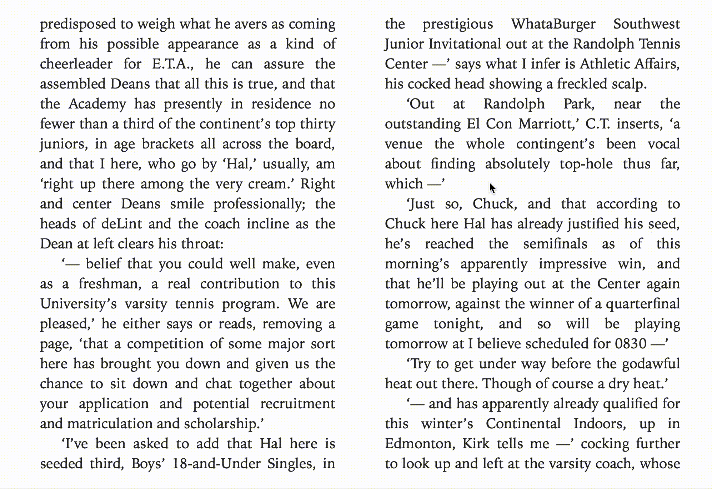
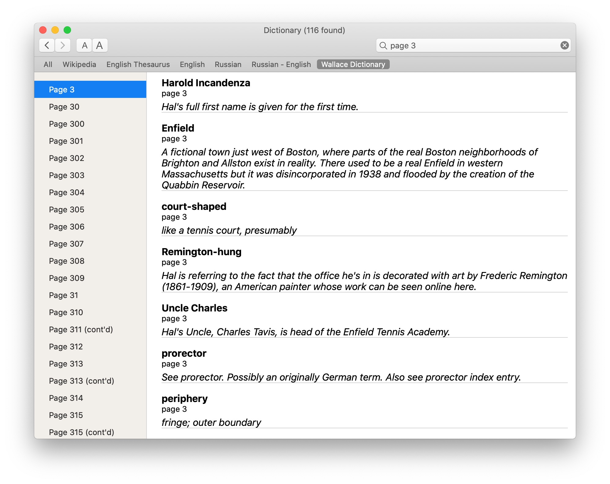
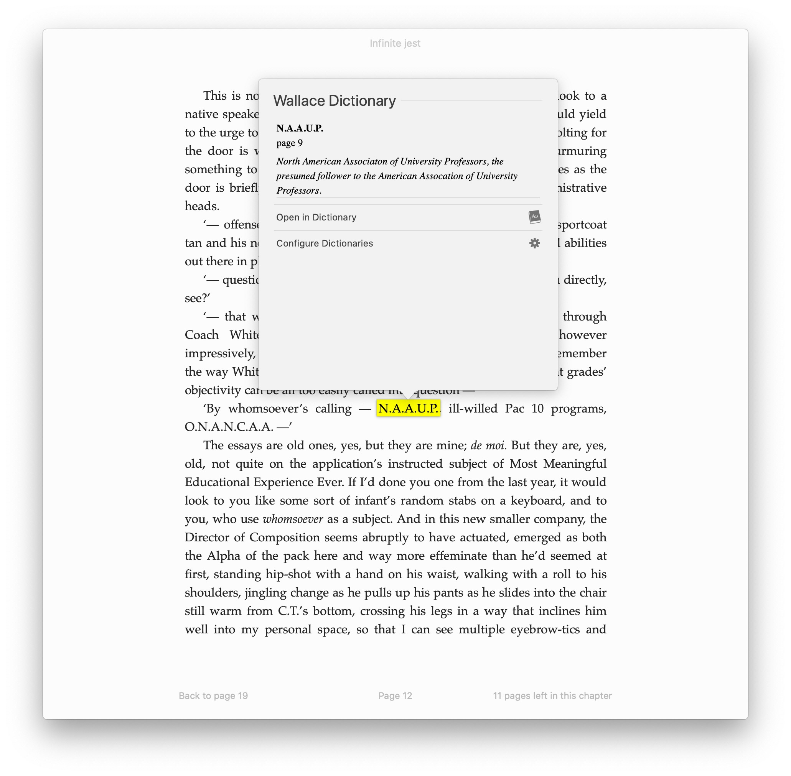
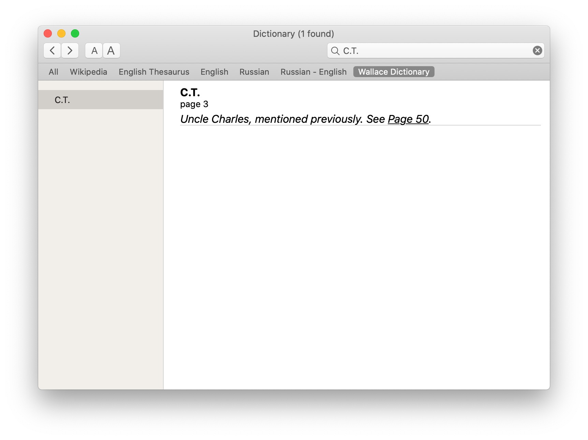

## macOS Dictionary scraped from David Foster Wallace Wiki : Infinite Jest

### Installation:

1. Download the latest `Wallace.Dictionary.dictionary.zip` from [releases](https://github.com/semyonf/wallace-apple-dictionary/releases) (under 'Assets')
2. Extract and move the extracted `.dictionary`-direcory to `~/Library/Dictionaries`, enable it in your Dictionary.app

### Building from source:

1. Install Node.js version 16 (required to parse fresh annotations from the website)
2. Run `npm i && make`
3. Run `make install` to add the dictionary

